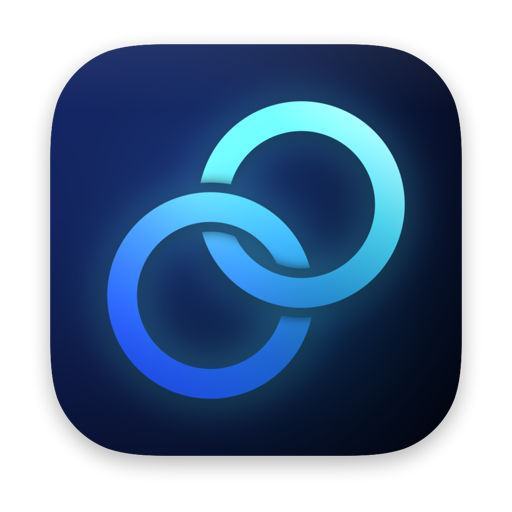
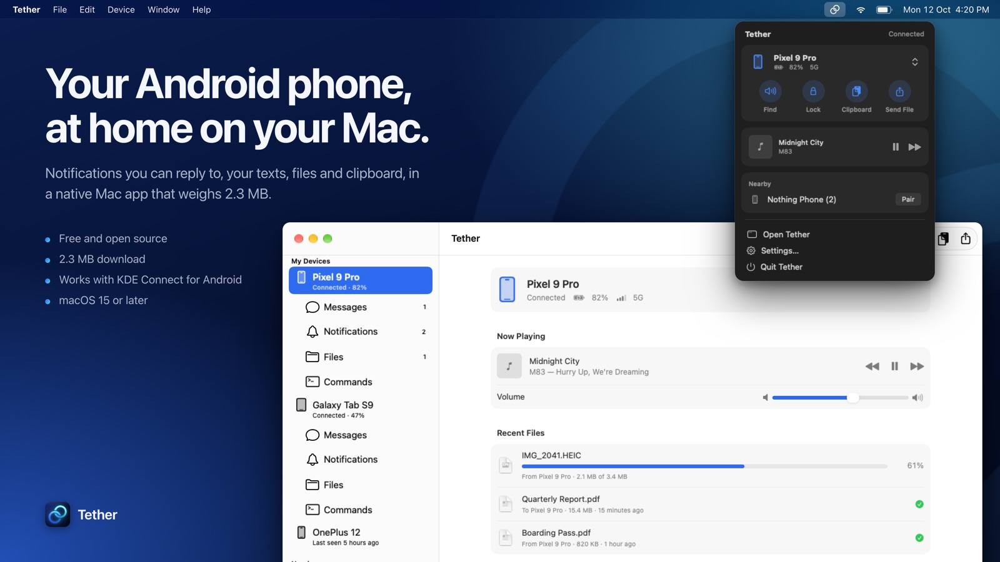
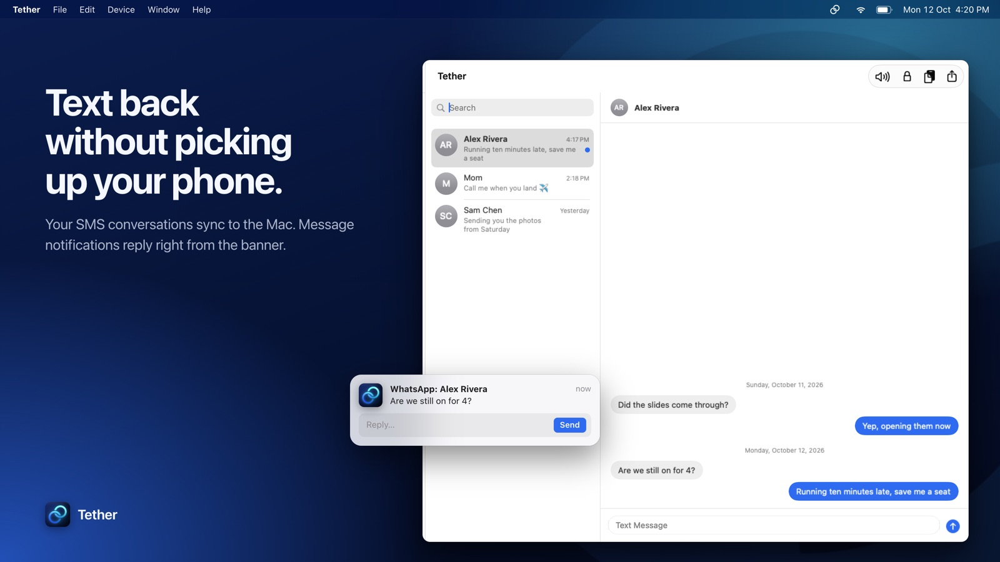
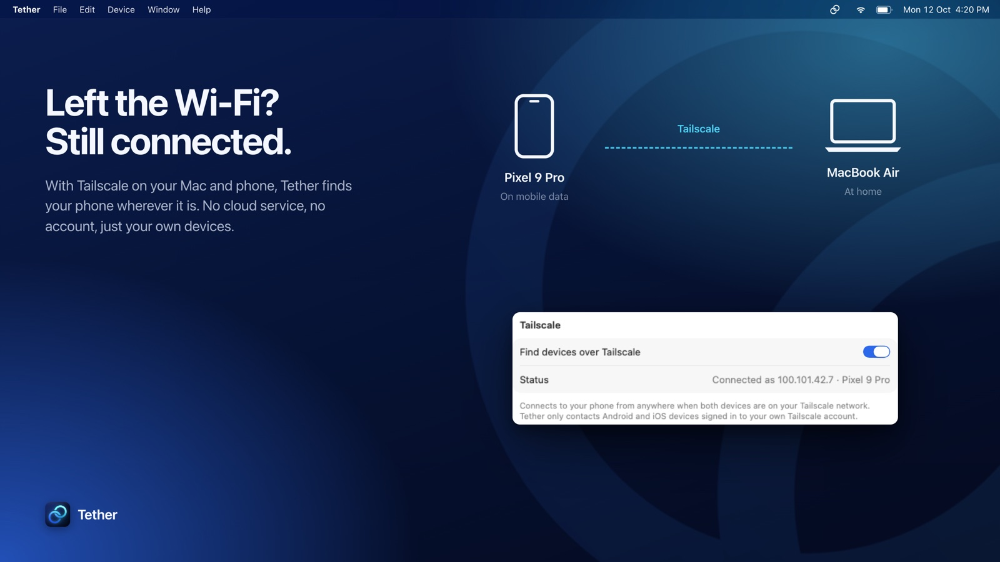
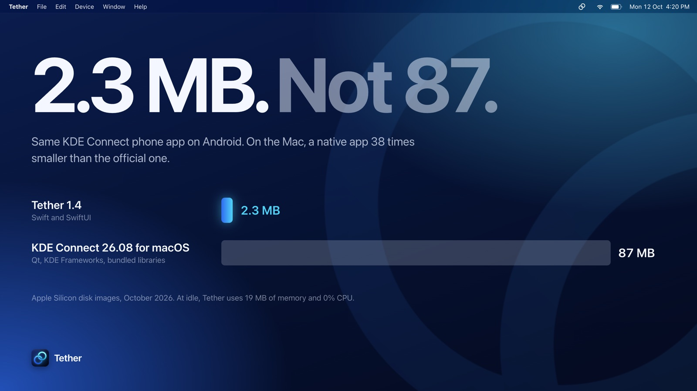

<p align="center">
  
</p>

<h1 align="center">Tether</h1>

<p align="center">
  <strong>Your Android phone, at home on your Mac.</strong><br />
  Notifications you can reply to, your texts, files and clipboard, in a native Mac app that weighs 2.3&nbsp;MB.
</p>

<p align="center">
  <a href="https://github.com/subhashhhhhh/Tether/releases/latest"></a>
  
  
  
</p>

<p align="center">
  
</p>

Tether is a native macOS app for the free **KDE Connect** app on Android. Pair your phone once, and from then on it shows up in your menu bar whenever it's nearby: phone notifications appear on your Mac and can be answered there, your text conversations sync, files and the clipboard move both ways, and you can ring, lock or control your phone without picking it up.

It is written entirely in Swift and SwiftUI, with no Qt, no Electron and no third-party libraries.

## Download

The easiest way is [Homebrew](https://brew.sh), which also skips the "can't be opened" warning described below:

```bash
brew install --cask subhashhhhhh/tether/tether
```

Or get the latest release from the **[Releases page](https://github.com/subhashhhhhh/Tether/releases/latest)**. There are two downloads; pick the one for your Mac:

| Your Mac | Download |
| --- | --- |
| Apple Silicon (M1 and later) | `Tether-<version>-AppleSilicon.dmg` |
| Intel | `Tether-<version>-Intel.dmg` |

Not sure? Apple menu → **About This Mac**: it says **Chip** on Apple Silicon and **Processor** on Intel. Tether needs **macOS 15 Sequoia** or later.

On the phone, KDE Connect may ask for permission to access files the first time Tether mounts it.

Once installed, Tether keeps itself up to date: it checks for a new version once a day, or whenever you choose **Tether › Check for Updates…**, and installs it in place.

On your phone, install **KDE Connect** from [Google Play](https://play.google.com/store/apps/details?id=org.kde.kdeconnect_tp) or [F-Droid](https://f-droid.org/packages/org.kde.kdeconnect_tp/).

## What it does

**Notifications, answered from the Mac.** Phone notifications appear in Notification Center. Messaging apps that support it (SMS, WhatsApp, Telegram, Signal and others) can be replied to right from the banner, and anything you dismiss on the Mac is dismissed on the phone. Sign-in codes get a **Copy Code** button, or can be copied automatically.

Phone-supplied notification images also appear in Tether’s notification list and, when available in time, as image attachments in Notification Center. macOS still uses Tether’s app icon; the phone image may be an avatar rather than the Android app logo. See [notification images and limitations](docs/notification-images.md).

When the native WhatsApp app is running on the Mac, Tether keeps phone WhatsApp notifications in its list but skips their system alerts to avoid duplicates. Quit WhatsApp to receive those alerts through Tether again. This includes WhatsApp running hidden or minimized; it does not check which account is signed in or whether WhatsApp's own alerts are enabled.

**Your texts.** SMS conversations sync to the Messages section, with names and photos from your phone's contacts. Read whole threads, reply, or start a new conversation. Calls show who's calling, with a button to mute the ringer, and whatever is playing on the Mac pauses until the call ends.

**Files, both ways.** Drop files anywhere in the Tether window or on the menu bar popover, or choose **Share › Tether** in Finder, Photos and other apps, to send them to your phone. With more than one phone connected, the Share menu asks which one. Files shared from your phone land in **Downloads** with live progress.

**Your phone as a drive.** While your phone is connected, it appears in Finder as a drive named after it, with an eject button. Browse its storage, open photos and documents straight from it, and drag files in and out. Files are read from the phone as you open them, so a video starts playing right away. It uses KDE Connect's file sharing, so it works over Wi-Fi and Tailscale with no setup and no administrator password. If you use ADB, you can switch to wireless debugging in **Settings › Files**.

**Clipboard, media and remote control.** Copy on one device, paste on the other. See what's playing on your phone, with artwork, and control playback and volume. It works the other way too: KDE Connect's Multimedia control on the phone shows what's playing on the Mac (Music, Spotify, a video in Safari) and sets the Mac's volume. **Find Phone** rings it at full volume, and **Ring** in KDE Connect on the phone rings your Mac.

**Your phone as a trackpad and presenter.** KDE Connect's Remote Input and Presentation tools move the pointer, click, scroll, type and show an on-screen laser pointer. This needs Accessibility access, which you can grant from Tether's Overview or Settings.

**Commands.** Set up shell commands on your Mac and run them from your phone, along with your Shortcuts if you choose. Tether can also lock the Mac when your phone leaves.

**Lives in the menu bar.** The menu bar popover shows your phone's battery and connection, quick actions, what's playing and new pairing requests. The main window lists your devices in the sidebar, with each phone's Overview, Messages, Notifications, Files and Commands as tabs. It uses Liquid Glass on macOS 26 and translucent materials on macOS 15.

<p align="center">
  
</p>

See the **[Roadmap](ROADMAP.md)** for what's coming next and what isn't possible with KDE Connect.

## Use it from anywhere with Tailscale

KDE Connect normally needs your phone and Mac on the same Wi-Fi. If you use [Tailscale](https://tailscale.com) on both, Tether finds your phone on your tailnet automatically, so everything keeps working when you're on mobile data or a different network.

- Tether only contacts Android and iOS devices that are signed in to **your own** Tailscale account. Devices shared with you by other people are never contacted.
- It reads your tailnet from the `tailscale` app on your Mac and never talks to Tailscale's servers.
- Turn it on or off in **Settings › General › Tailscale**. **Connect by Address…** also accepts Tailscale names such as `phone.tailnet.ts.net`.

<p align="center">
  
</p>

## Small, and quiet when idle

<p align="center">
  
</p>

| | Tether 1.8 | KDE Connect 26.08 for macOS |
| --- | --- | --- |
| Download (Apple Silicon disk image) | **2.6 MB** | 87 MB |
| Installed app | **4.3 MB** | |
| Memory while idle | **23 MB** | |
| CPU while idle | **0%** | |

Measured in October 2026 on an Apple Silicon Mac: Tether's numbers come from the 1.8 release in the background while connected to a phone, with its contacts and messages synced, and the official app's download size from KDE's release builds. The empty cells weren't measured. With the window open, Tether uses more, about 50 to 80 MB while you read long conversations.

## Privacy and security

- **No cloud.** Your phone and Mac talk directly over your local network, or over your own Tailscale network. There are no Tether servers, accounts, analytics or telemetry.
- **Encrypted.** Every connection and file transfer uses TLS.
- **Pinned to your phone.** Pairing saves your phone's certificate, and every later connection and file transfer must present that exact certificate. A device that only pretends to be your phone is refused.
- **Updates are verified.** Every release is signed with the same certificate, and Tether only installs an update signed with the certificate it was signed with itself. See [docs/signing.md](docs/signing.md).
- **Your Mac's identity stays private.** Tether's certificate and key live in `~/Library/Application Support/Tether`, readable only by your user account, and are loaded into memory rather than the keychain.

## Install and pair

1. Install with Homebrew, or open the disk image and drag **Tether** into **Applications**.
2. Open Tether. It lives in the menu bar.
3. On your phone, open **KDE Connect** and tap your Mac in the device list. Tether asks you to confirm: click **Pair**.

Your phone shows up under **Nearby** in Tether's sidebar too, if you'd rather start pairing from the Mac. If it doesn't appear, use **Connect by Address…** with the phone's IP address or Tailscale name.

### "Tether can't be opened"

Tether isn't notarized by Apple (that needs a paid developer account), so macOS blocks a downloaded copy the first time. Homebrew installs aren't affected. Otherwise:

1. Try to open Tether, then close the warning.
2. Open **System Settings → Privacy & Security**, scroll to **Security** and click **Open Anyway**.

Or, in Terminal:

```bash
xattr -cr /Applications/Tether.app
```

## Build from source

You need **Xcode 26** or later (the project uses Swift 6.2's default main-actor isolation). There are no package dependencies.

```bash
git clone https://github.com/subhashhhhhh/Tether.git
cd Tether

# Run the tests
xcodebuild test -project Tether.xcodeproj -scheme Tether -destination "platform=macOS"

# Build the app (ends up in build/Build/Products/Release/Tether.app)
xcodebuild -project Tether.xcodeproj -scheme Tether -configuration Release -derivedDataPath build build

# Build the two release disk images (Apple Silicon and Intel) into dist/
scripts/release.sh
```

`release.sh` signs with the maintainer's "Tether Self-Signed" certificate; see [docs/signing.md](docs/signing.md) for why, and for testing the updater with `scripts/test-updater.sh`.

### How it works

- **UI:** SwiftUI with `@Observable` view models and stock controls, with Liquid Glass on macOS 26 and materials on macOS 15, so it follows Light and Dark mode, your accent colour and accessibility settings.
- **Phone drive:** a small NFS version 3 server on the loopback interface, mounted by the user with `mount_nfs` and named through a local-only Bonjour host, backed by SFTP (a native SSH client on CryptoKit) or ADB.
- **Networking:** BSD sockets with `poll()`-driven I/O and Security framework TLS. KDE Connect upgrades an open connection to TLS after a plaintext handshake, which `Network.framework` can't do.
- **Identity:** created once with the `openssl` tool that ships with macOS, then loaded in memory by the Security framework.
- **Mac's Now Playing:** since macOS 15.4 only Apple-signed programs may read it, so Tether runs [mediaremote-adapter](https://github.com/ungive/mediaremote-adapter) (BSD-3) through `/usr/bin/perl`. It's built from source by `scripts/build-mediaremote-adapter.sh` and lives in `Vendor/`.

## License

GPL-2.0, like the KDE Connect ecosystem. See [LICENSE](LICENSE). Tether includes mediaremote-adapter by Jonas van den Berg, under the BSD 3-Clause License ([Vendor/MediaRemoteAdapter/LICENSE](Vendor/MediaRemoteAdapter/LICENSE)).

Tether is an independent project and isn't affiliated with KDE.
